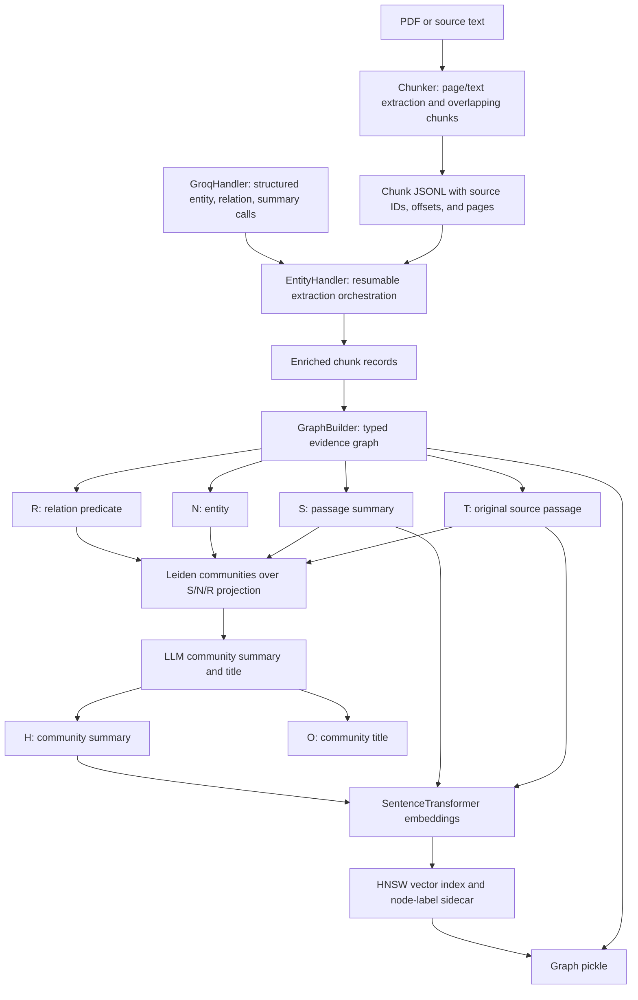

# GraphRAG project: architecture and latest-run report

**Report prepared:** 2026-10-09  
**Latest complete experiment documented:** Align-GRAG-style retrieval evaluation, run date 2026-10-08  
**Scope:** the repository's PDF/book GraphRAG pipeline and an auditable manifest of the latest saved experiment.

This report describes both the implemented application architecture and what the latest evaluation actually executed. These are not the same thing: the app's online path currently uses HNSW/PPR and a cross-encoder; the Align-GRAG-style model was trained and evaluated offline and is not loaded by `app.py`.

## 1. User problem and success criteria

A reader needs to ask questions that connect information scattered across a long book or PDF. A plain chunk search can miss a relevant passage when the question uses different wording, and a model given an oversized document may omit evidence or invent links. The system therefore keeps original source passages as evidence, builds a graph to connect entities and sections, retrieves passages for the live user query, and constrains answer generation to retrieved evidence with source citations.

For this project's intended use, a successful system should:

1. preserve source provenance from PDF page or text character ranges through the index;
2. find all supporting spans for a question that needs information from multiple parts of the book;
3. place relevant evidence high in the ranking and keep it in the final context budget;
4. answer only from that context, cite the original evidence, and abstain when it is missing; and
5. beat simple lexical retrieval on a held-out set without tuning against that held-out set.

The current evidence supports a useful prototype and a strong result for one retriever configuration on one small book-specific test set. It does not establish general performance across books or subject domains.

## 2. System architecture

### 2.1 Offline indexing and graph construction



1. **Read and preserve source.** `Chunker.pdf_to_pages` extracts page text from a text-based PDF; `pdf_to_text` handles plain text; `segment_into_chunks` creates overlapping chunks; `write_chunks` persists JSONL. The record structure carries source ID and, where available, page range and character offsets. The PDF path does not OCR scanned pages or reconstruct table/figure layout.
2. **Annotate chunks.** `EntityHandler.process_documents` runs requested extraction stages over saved chunks and writes progress/checkpoints. `GroqHandler` requests entity lists, relation triples, and summaries and parses the responses. `retry_stored_unprocessed_documents` retries incomplete work. This separation makes a partially rate-limited build resumable.
3. **Build typed graph.** `GraphBuilder.build_graph` constructs `T` source-passage nodes and `S` summary nodes; `N` entity nodes are shared across passages; `R` relation nodes encode a predicate and connect to subject/object entities. Typical edges include `derived_from`, `mentions`, `mentions_entity`, `asserts`, `subject`, and `object`. Source IDs, pages, and character ranges are attached to evidence-bearing nodes/edges where available.
4. **Group related concepts.** `detect_and_save_communities` projects the `S/N/R` subgraph to an undirected graph and applies Leiden modularity community detection. It aggregates summary text and relation triples for each community. This gives retrieval a coarse organization over cross-passage themes; it does not itself prove that a generated community summary is factually correct.
5. **Add community navigation nodes.** `EntityHandler` asks for a high-level community summary and title. `GraphBuilder.add_HO_nodes_from_community_map` adds `H` summary and `O` overview/title nodes and connects them to community summaries. `finalize_graph_G3_from_community_map` adds semantic links among embedded summary nodes.
6. **Attach source evidence and build vector index.** `build_G4_text_attachment` attaches original text chunks as `T` nodes and links them to entities. `build_G5_semantic_hnsw_index` embeds `T/S/H` text with `all-MiniLM-L12-v2`, adds HNSW semantic links where their community/similarity rules permit, writes a cosine-space HNSW index, and writes a `.nodes.json` mapping/fingerprint. Graph and index must be saved and loaded as a matching pair.

### 2.2 Online question answering path in `app.py`


1. The user supplies the query at request time. No query is known or packed in advance.
2. `GraphBuilder.get_entry_points` combines HNSW neighbors with lexical passage candidates and exact-ish token overlap against `N` entity and `O` title labels. The saved index sidecar maps vector labels back to graph node IDs and checks the mapping fingerprint.
3. `personalized_pagerank_scores` walks a symmetrized weighted graph from those query-specific seeds. This lets evidence spread across entity, relation, summary, and passage links. The current retriever uses shallow settings (`alpha=0.5`, up to 10 iterations in the HNSW/PPR path) to keep expansion bounded.
4. `PassageRetriever.hnsw_graph_expand` converts PPR scores back to the original `T` passages. The configured app default is `hnsw_ppr_crossencoder`; `PassageRetriever.rank` reranks a bounded candidate list with `cross-encoder/ms-marco-MiniLM-L-6-v2`.
5. `passage_context_record` restores source text and provenance. `GraphAugmentedGenerator.textualize_ranked_passages` delegates to `TokenBudgetPacker.pack`, which adds complete passages in retrieval order until the tokenizer budget is reached; it does not silently cut a source passage mid-span.
6. `GraphAugmentedGenerator.build_prompt` asks the LLM to answer from the supplied evidence, prefer original `T` text over summaries, cite pages or source IDs, and say when support is insufficient. `generate_answer` calls the configured chat endpoint. The app displays the answer and retrieved source passages.

### 2.3 Latest offline Align-GRAG-style experiment

The most recent saved run is a retrieval/pruning experiment, not an online app deployment and not a complete reproduction of the Align-GRAG paper.

```mermaid
flowchart TD
    Q[60 reviewed questions: 37 dev, 23 held out] --> SEEDS[Saved HNSW and shallow PPR candidates]
    G[Read-only saved graph: 1,997 nodes, 10,325 edges] --> SEEDS
    SEEDS --> FEAT[all-MiniLM-L12-v2 node, query, rationale, anchor features]
    Q --> SUP[Dev-only rationale/anchor targets; source-quote fallback]
    SUP --> TRAIN[Mean GraphSAGE node scorer]
    FEAT --> TRAIN
    TRAIN --> LOSS[Anchor KL + symmetric graph/rationale InfoNCE]
    LOSS --> CV[Grouped 4-fold CV: choose epochs and seed/pruning count]
    CV --> FIT[Refit on dev questions]
    FIT --> TEST[Rank held-out T passages; pack under 4,096-token budget]
    TEST --> METRICS[Recall@k, MRR, nDCG@10, packed span coverage, paired bootstrap]
```

1. The runner loads, but does not rebuild or mutate, `data/book-graph/graph.pkl` and its HNSW index. It uses the saved 60-question reviewed file with 37 development and 23 held-out questions.
2. It makes one shared candidate subgraph per query using saved HNSW entry points and shallow PPR. Both the Align-style model and the no-contrastive-loss ablation receive the same candidate subgraph.
3. It embeds graph node text, query, anchor, and rationale with `all-MiniLM-L12-v2`. `AlignGRAGAligner` applies two mean-aggregation GraphSAGE layers, a query-conditioned node scoring MLP, and a shared graph/text projection head.
4. `anchor_kl_loss` trains the predicted node distribution toward a cosine-derived anchor distribution. `symmetric_info_nce` contrasts each candidate graph representation with its rationale embedding in both graph-to-text and text-to-graph directions. The dual model uses both; the KL-only ablation omits contrastive loss.
5. Development examples are grouped into four CV folds so questions sharing labeled evidence passages stay together. The selection sweep considers epoch counts 5/10/20 and seed counts 5/10/20. Selected settings were five epochs, 20 seeds, AdamW learning rate `1e-4`, weight decay `1e-4`.
6. On evaluation, aligned node scores select seeds and one-hop neighbors; retained `T` nodes are ordered by node score as a passage-ranking adapter. The same 4,096-token whole-passage context budget and exact-span labels are used to compare methods.

**Baseline handling:** the BM25 and HNSW/PPR/cross-encoder per-question rankings and scores are copied from the hash-checked `results/book-retrieval-final.json`; the Align runner does not recompute those two baselines or reload the cross-encoder. It recomputes HNSW/PPR candidates for its graph-only baseline and computes the Align-style rankings on the held-out set. The frozen baseline was created by the preceding controlled retrieval run against the same graph and reviewed question file. This distinction matters when interpreting the displayed table as one combined comparison.

**Supervision limitation:** the 37 development examples all used `source_quote_fallback` supervision. The saved provider metadata records `rate_limit_exceeded` failures (HTTP 413 responses) across the configured key/model combinations and no successful model. The fallback anchors/rationales are constructed from answer/source quotes, not independently authored rationales. No held-out answers or rationales were used for training or configuration selection.

**Paper-fidelity limitation:** this prototype tests graph-text alignment losses and node scoring on an existing graph candidate. Its evaluation adapter ranks passages using node logits. It does not implement the paper's complete retrieval/pruning and graph-representation-to-generator path, and no learned continuous graph representation was passed into the hosted LLM. Thus the metrics below are retrieval metrics only.

## 3. Latest-run results

**Test set:** 23 held-out questions. The dev set has 37 questions. The graph has 1,997 nodes, 10,325 edges, and 95 source passages with usable source offsets. Context budget: 4,096 tokenizer tokens. Gold relevance is based on annotated exact source spans.

| Method | Evidence Recall@1 | Recall@5 | Recall@10 | MRR | nDCG@10 | Packed span recall | All evidence packed |
|---|---:|---:|---:|---:|---:|---:|---:|
| BM25 | 0.652 | 0.935 | 0.978 | 0.794 | 0.771 | 0.978 | 0.957 |
| HNSW + PPR | 0.435 | 0.913 | 1.000 | 0.679 | 0.712 | 1.000 | 1.000 |
| Align-style KL only | 0.022 | 0.239 | 0.630 | 0.163 | 0.188 | 0.565 | 0.522 |
| Align-style dual loss | 0.022 | 0.326 | 0.609 | 0.176 | 0.201 | 0.522 | 0.478 |
| HNSW + PPR + cross-encoder | **0.848** | **1.000** | **1.000** | **0.957** | **0.923** | **1.000** | **1.000** |

Metric definitions used for the saved benchmark:

- **Evidence Recall@k** = number of gold quote spans fully covered by the union of source character intervals in the top `k` passages, divided by the number of gold quote spans.
- **MRR** = `1 / rank(first passage overlapping any gold evidence span)`; zero if none is found.
- **nDCG@10** = `DCG@10 / IDCG@10`, with passage relevance graded by the count of gold evidence quotes it overlaps and logarithmic rank discount.
- **Packed span recall** applies the same interval-union span coverage to only the passages that fit in the final 4,096-token context.
- **All evidence packed** = fraction of questions where every gold span is covered by that final packed context.

The held-out category distribution was 18 `single_fact`, four `multi_evidence_reasoning`, and one `multi_evidence_lookup` question.

The selected existing cross-encoder method improved nDCG@10 by 0.152 and MRR by 0.163 over BM25. Align-style dual loss was below BM25 by 0.569 nDCG and 0.618 MRR, and below the cross-encoder by 0.721 nDCG and 0.781 MRR (rounded from the unrounded saved means). In the reported paired per-question bootstrap with 5,000 resamples, Align dual minus cross-encoder 95% intervals were `[-0.800, -0.643]` for nDCG@10, `[-0.866, -0.676]` for MRR, and `[-0.587, -0.196]` for Recall@10. Align dual minus BM25 intervals were `[-0.677, -0.461]`, `[-0.746, -0.483]`, and `[-0.565, -0.174]` respectively.

One concrete failure is held-out question `cur-test-009` about recovering from dementia: Align dual returned no labeled evidence in its top ten (nDCG@10 0.000), while BM25 and the cross-encoder ranked the supporting evidence first (nDCG@10 1.000).

**Interpretation and limits:** the graph-expansion-plus-cross-encoder pipeline is the best tested retrieval method here. The Align-style result is a negative result for this implementation and fallback supervision; it is not evidence that the paper's full method is inferior. The test set is small and assistant-authored/source-audited, not independently annotated by clinical experts. Category counts are imbalanced (18 single-fact, four multi-evidence reasoning, one multi-evidence lookup). No generation-quality metrics belong to this Align run: it made zero answer-generation calls. A separate prior frozen-context generation artifact exists and must not be combined with these retrieval scores as if it came from this run.

## 4. Last-run file manifest

The following separates files the Align-GRAG run actually read or wrote from files that are only upstream provenance or unrelated project material. A report's mere presence in the repository does not mean the script consumed it.

### 4.1 Direct inputs and configuration

| File | Role in the 2026-10-08 run |
|---|---|
| `scripts/book/run_book_align_grag_eval.py` | Main entry point: load data, prepare candidates/supervision, cross-validate, fit, evaluate, write outputs. |
| `modules/align_grag.py` | Mean GraphSAGE, query-conditioned scorer, graph/text projection, KL and InfoNCE losses. |
| `modules/graph_builder.py` | Loads/uses the saved graph; provides encoder, entry-point lookup, HNSW mapping checks, PPR, and passage retriever factory. Graph-building methods were not called. |
| `modules/retrieval.py` | Provides passage enumeration from `T` nodes, HNSW/PPR expansion, BM25/cross-encoder methods used by the benchmark family, and tokenizer-based whole-passage packing. This run uses passage enumeration, HNSW/PPR, and packing; frozen BM25/cross-encoder rankings are read from the baseline JSON. |
| `modules/groq_handler.py` | Supplies the configured supervision provider/fallback metadata; provider attempts failed, so fallback supervision was used. No answer-generation call was made. |
| `scripts/book/run_book_retrieval_benchmark.py` | Imported helper functions for span metrics, context packing, bootstrap intervals, JSON hashing, and summaries; no new tuning run was performed by this helper import. |
| `data/book-graph/graph.pkl` | Loaded source graph. SHA-256: `f0b9ed825613400d8202b6b6a14031983ce2ca612d638c91bcd978aa826d8230`. |
| `data/book-graph/graph-index.bin` | Existing HNSW index used for query entry points. SHA-256: `7e02ab8887d3c3e0a3cc6f9eab963a03ac8fa2c19293ae99b9508ea4e513d291`. |
| `data/book-graph/graph-index.bin.nodes.json` | HNSW label-to-node mapping and graph-text fingerprint, checked during retrieval. |
| `data/book-graph/eval_questions.reviewed.jsonl` | All 60 questions and evidence labels, split into 37 dev and 23 held out. SHA-256: `0dc8a933203e8f16907ca606120f583b07d2f5ca9602c669cc1fa6866c83398d`. |
| `results/book-retrieval-final.json` | Frozen prior retrieval result used to validate matching graph/question hashes and obtain tokenizer/context settings and comparison baseline. SHA-256: `9f5aad601798b7dc37470b39e7a40c75762adbcb60bb1d2d261ff5038c9a04eb`. |
| `.env` | Loaded local runtime settings and credentials for attempted dev supervision only. The file is ignored by Git; its secret values are intentionally not reproduced here. |
| `requirements.txt` and installed `.venv` packages | Runtime dependencies. Relevant packages include PyTorch, sentence-transformers/Transformers, NetworkX, hnswlib, NumPy/SciPy, python-dotenv, and the project dependencies for graph/retrieval code. `torch_geometric` was absent; this implementation uses ordinary PyTorch. |

External pretrained assets resolved by the libraries are not stored in this repository: `sentence-transformers/all-MiniLM-L12-v2` for embeddings and the tokenizer identified as `openai/gpt-oss-120b` in the frozen retrieval metadata are loaded in this run. The frozen cross-encoder rankings were produced by the earlier baseline run using `cross-encoder/ms-marco-MiniLM-L-6-v2`; the Align runner does not reload that cross-encoder. For strict reproduction, pin package versions and model revisions; the saved artifacts do not record immutable model revision hashes.

### 4.2 Outputs written by the run

| File | Output |
|---|---|
| `results/align-grag-supervision.jsonl` | 37 development-only rationale/anchor records; all marked `source_quote_fallback`. |
| `results/align-grag-supervision-meta.json` | Graph/question hashes, dev IDs, provider/key-slot/model metadata and failures. Contains no API key values. |
| `results/align-grag-eval.json` | Full evaluation output: run metadata, CV selection, training losses, held-out per-question rankings and aggregate metrics. |
| `results/align-grag-aligner.pt` | Saved dual and KL-only model state dictionaries plus selected config and source hashes. |
| `results/align-grag-evaluation-report.md` | Generated human-readable summary of the evaluation. |

### 4.3 Upstream source and saved graph provenance (not read as raw text by this run)

| File | Relationship to the run |
|---|---|
| `data/medical-CareForInsane/book.txt` | Source corpus from which the book graph was previously prepared; the Align runner read the saved graph, not this source text. |
| `data/book-graph/chunked_output.jsonl` | Earlier chunk/extraction records associated with this graph. The Align evaluation path uses passage text/offsets already in `graph.pkl`; it does not rebuild from this JSONL. |
| `data/book-graph/community_map.json` | Earlier community assignment/summary input used to build the saved graph; not rerun. |
| `data/book-graph/eval_questions.generated.jsonl` | Generated/pre-review question set; not used for scoring. The reviewed JSONL is the evaluation input. |
| `data/book-graph/progress.json` and `data/book-graph/ProgressCheckpoint-relationship-1.json` | Previous extraction progress artifacts; not read by the Align runner. |
| `Align-GRAG.pdf`, `NodeRAG.pdf` | Research references in the repository; not opened by the evaluation script. |
| `graphrag-final.ipynb` | Research/development notebook; not executed by the saved Align run. |

The question and graph hashes in the result metadata provide a reproducibility guard: the runner checks that the frozen baseline refers to the same graph and question file before evaluation.

## 5. Repository inventory and cleanup map

This is the project-file inventory after grouping the Python runners. `.venv/`, `.env`, and Python bytecode caches are local runtime material and are excluded from Git. Nothing in the corpus, graph artifacts, papers, notebooks, or saved results was deleted.

### Root files

| File | Purpose / relation to latest run |
|---|---|
| `README.md` | Setup, app usage, prior medbook and retrieval instructions; runnable commands updated for script folders. |
| `PROJECT_REPORT.md` | Earlier project report, retained unchanged for history. |
| `PROJECT_REPORT_DETAILED.md` | This architecture explanation and latest-run manifest. |
| `RAG_EVAL_METRICS.md` | Retrieval/generation metric definitions; documentation, not loaded by the run. |
| `.gitignore` | Excludes local secrets, virtual environments, and bytecode/cache artifacts. |
| `.env.example` | Safe configuration template; not a credential source for this run. |
| `.env` | Local settings/keys, ignored and not included in this report. |
| `requirements.txt` | Python dependency list. |
| `app.py` | Streamlit online interface. Not launched by the offline Align run. |
| `graphrag-final.ipynb` | Main development notebook; not executed by the offline run. |
| `medbook.pdf` | Separate PDF experiment input; not used by the latest book-graph run. |
| `Align-GRAG.pdf`, `NodeRAG.pdf` | Included paper references; not runtime inputs. |

### Application and model modules

| File | Main responsibility |
|---|---|
| `modules/chunker.py` | PDF/plain-text ingestion, page extraction, chunking, and chunk persistence. |
| `modules/entity_handler.py` | Extraction workflow, retries, progress and checkpoint persistence. |
| `modules/groq_handler.py` | Structured LLM requests, key/model fallback, parsing, and provider metadata. |
| `modules/graph_builder.py` | Typed graph construction, Leiden communities, H/O nodes, HNSW index, entry points, PPR, graph save/load. |
| `modules/retrieval.py` | BM25, exact dense ranking, RRF, graph expansion, HNSW/PPR, cross-encoder reranking, intact passage packing. |
| `modules/generator.py` | Passage/graph serialization, evidence-grounded prompt assembly, answer call, optional embedding persistence. |
| `modules/evaluator.py` | QA evaluation, answer metrics, page/evidence/citation/abstention scoring, aggregation and result writing. |
| `modules/align_grag.py` | Offline Align-GRAG-style GraphSAGE aligner and training losses; used by the latest run, not the online app. |
| `modules/gnn_models.py` | Alternate/earlier `NodeAlignerGNN`; not used by `app.py`'s active retrieval path or the latest Align runner. |

### Script folders

| File | Purpose |
|---|---|
| `scripts/README.md` | Script index and invocation examples. |
| `scripts/book/prepare_book_eval_questions.py` | Prepare/review book-specific QA/evidence annotations; not invoked by the latest run. |
| `scripts/book/run_book_retrieval_benchmark.py` | Controlled benchmark and metric helpers; helper functions imported by the latest Align runner. |
| `scripts/book/run_book_generation_eval.py` | Generation evaluation on frozen retrieved contexts; separate from latest Align run. |
| `scripts/book/run_book_align_grag_eval.py` | Latest experiment entry point. |
| `scripts/medbook/run_medbook_demo.py` | Bounded `medbook.pdf` page-slice graph and QA experiment. |
| `scripts/medbook/run_medbook_fulltext.py` | Full-PDF passage index and separated retrieval/generation evaluation. |
| `scripts/medbook/run_medbook_retrieval_benchmark.py` | Controlled exact-span retrieval benchmark for medbook. |
| `scripts/legacy/run_textbook.py` | Earlier generic text-book graph/QA pipeline for `book.txt`. |

### Data files

| File(s) | Purpose / relation to latest run |
|---|---|
| `data/medical-CareForInsane/book.txt` | Original text book; upstream graph provenance, not directly read by latest run. |
| `data/book-graph/graph.pkl`, `graph-index.bin`, `graph-index.bin.nodes.json` | Saved full book graph and matching HNSW artifacts; direct inputs to latest run. |
| `data/book-graph/eval_questions.reviewed.jsonl` | Direct latest-run question/evidence input. |
| `data/book-graph/chunked_output.jsonl`, `community_map.json`, `eval_questions.generated.jsonl`, `progress.json`, `ProgressCheckpoint-relationship-1.json` | Earlier build/question-generation artifacts; provenance/supporting artifacts, not all directly loaded by the latest run. |
| `data/medbook-demo_questions.jsonl`, `data/medbook-full_questions.jsonl`, `data/medbook-retrieval-benchmark.jsonl` | Separate medbook question/evidence sets; not latest-run inputs. |
| `data/medbook-demo/chunked_output.jsonl`, `community_map.json`, `graph.pkl`, `graph-index.bin`, `graph-index.bin.nodes.json`, `incomplete_graph_elements.json`, `progress.json`, `ProgressCheckpoint-relationship-1.json`, `ProgressCheckpoint-relationship-2.json`, `ProgressCheckpoint-relationship-3.json` | Bounded medbook demo artifacts; separate experiment. |
| `data/medbook-full/chunked_output.jsonl`, `progress.json` | Partial/LLM-enriched full-book attempt artifacts; separate experiment. |
| `data/medbook-full-text/chunked_output.jsonl`, `graph.pkl`, `graph-index.bin`, `graph-index.bin.nodes.json` | Full passage-only medbook corpus index; separate experiment. |

### Results files

| File(s) | Purpose / relation to latest run |
|---|---|
| `results/align-grag-aligner.pt`, `align-grag-eval.json`, `align-grag-evaluation-report.md`, `align-grag-supervision.jsonl`, `align-grag-supervision-meta.json` | Five outputs from the latest run, described in the manifest above. |
| `results/book-retrieval-final.json` | Direct frozen input/baseline for latest run. |
| `results/book-retrieval-selected-config.json`, `book-retrieval-tuning.json` | Prior retrieval tuning artifacts; not direct reads of latest run. |
| `results/book-retrieval-generation-final.json` | Separate generation-on-frozen-context experiment; not part of latest Align metrics. |
| `results/book-text-evaluation-report.md`, `book-text-generation-final.json`, `book-text-results.json`, `book-text-results-12k-retry.json`, `book-text-results-initial-24k.json`, `book-text-retrieval-eval.json`, `book-text-retrieval-final.json`, `book-text-retrieval-tuning-report.md` | Earlier text-corpus runs/evaluations; not inputs to latest run. |
| `results/medbook-demo-results.json`, `medbook-full-generation-results.json`, `medbook-full-retrieval-results.json`, `medbook-full-text-results.json`, `medbook-retrieval-benchmark.json`, `medbook-retrieval-benchmark-contexts.jsonl` | Separate PDF-slice/full-PDF runs; not inputs to latest run. |

### Other supporting files

| File | Purpose / relation to latest run |
|---|---|
| `docs/architecture.svg` | Existing architecture drawing, documentation only. |
| `extras/icdec (1).ipynb`, `extras/touche-deberta.ipynb`, `extras/touche-task2-final.ipynb` | Separate experiments, unrelated to this GraphRAG run. |

## 6. Component-level design notes

| Component and core functions | Input → output | Why it matters |
|---|---|---|
| `Chunker.pdf_to_pages`, `pdf_to_text`, `segment_into_chunks`, `write_chunks` | PDF pages or text → JSONL chunks with provenance | Maintains the mapping from retrieved text back to its source. Chunk size/overlap trades extraction cost against context fragmentation. |
| `GroqHandler._call_groq`, `extract_entities`, `extract_relations`, `generate_summary`, `generate_highlevel_summary`, `generate_title` | Prompt and source chunk/community → parsed structured result | Supplies the semantic annotations that let graph paths cross lexical gaps. The key-major fallback sequence tries models 1–3 on key 1 before moving to key 2. |
| `EntityHandler.process_documents`, `retry_stored_unprocessed_documents`, `save_progress`, `load_progress` | Chunk/community records → enrichment/checkpoints | Isolates provider failure and resumes partial processing instead of silently discarding failed chunks. |
| `GraphBuilder.build_graph`, `detect_and_save_communities`, `add_HO_nodes_from_community_map`, `finalize_graph_G3_from_community_map`, `build_G4_text_attachment`, `build_G5_semantic_hnsw_index` | Enriched JSONL and community map → graph, HNSW index, sidecar | Combines exact source evidence with entity/relation and community navigation structure. |
| `GraphBuilder.get_entry_points`, `_lexical_candidates`, `personalized_pagerank_scores`, `run_shallow_ppr` | Live query and saved graph/index → scored candidate subgraph | Seeds graph traversal with query evidence and propagates relevance through links. PPR is a recall-oriented expansion stage; it is not the final evidence ranking by itself. |
| `PassageRetriever.bm25`, `dense`, `rrf`, `graph_expand`, `hnsw_graph_expand`, `cross_rerank`, `rank` | Query and corpus → ranked original passages | Keeps the evaluation unit as source passages so exact-span retrieval metrics are meaningful; lets sparse/dense/graph/reranking methods be compared under one interface. |
| `TokenBudgetPacker.pack` | Ranked passages and tokenizer budget → intact final context | Prevents a retrieved source span from being cut mid-passage and directly measures what can reach the generator. |
| `GraphAugmentedGenerator.textualize_ranked_passages`, `textualize_graph`, `build_prompt`, `generate_answer` | Query, graph/passages → grounded answer | Converts graph navigation into source evidence, enforces citation/abstention instructions, and calls the answer model. |
| `NodeRAGEvaluator.evaluate_pdf_questions`, `evaluate`, `aggregate`, `save_results` | QA labels and generated predictions → retrieval/answer/citation metrics | Supports the separation of evidence retrieval from answer quality; the latest Align experiment instead uses its dedicated controlled-span benchmark. |
| `AlignGRAGAligner.encode_graph`, `forward`, `project_graph_text`; `anchor_kl_loss`, `symmetric_info_nce` | Candidate node features, adjacency, query and rationale → node logits/graph embedding/loss | Adds trainable query-to-node alignment and graph-to-rationale alignment on top of the existing candidate graph. |
| Align runner `make_supervision`, `initial_graphs`, `embed_all_graph_nodes`, `graph_example`, `attach_supervision`, `train_epochs`, `cross_validate`, `predict_aligned_ranking`, `evaluate_models`, `add_crossencoder_pairwise_intervals` | Saved graph/questions → model, rankings and uncertainty estimates | Separates candidate generation, supervision, development-only model selection, frozen held-out measurement, and paired method comparisons. |

## 7. What the latest result does and does not establish

- **Established for this benchmark:** HNSW/PPR candidate generation followed by the existing cross-encoder scored best among the five tested methods on the 23 held-out questions and beat BM25 on MRR and nDCG@10.
- **Not established:** general superiority on other books, a medically validated knowledge base, improved final answer correctness, or a full Align-GRAG paper reproduction.
- **Main risks:** small, assistant-authored question set; fallback rationale/anchor quality; possible annotation and query-style bias; one-book graph; potential parser loss on tables/figures/scans; and no generation evaluation in this last run.
- **Most useful next experiment:** obtain independently authored and adjudicated questions/evidence spans with a larger number of multi-hop queries across another long book, freeze the graph and test split, then rerun the same retrieval baselines and a generation pass on each method's own retrieved context. To assess generation fairly, report answer correctness, evidence faithfulness/citation support, and abstention separately from retrieval coverage.

## 8. Reproduction and repository organization

The latest run can be invoked from the repository root:

```powershell
.\.venv\Scripts\python.exe scripts\book\run_book_align_grag_eval.py
```

The run's default inputs and outputs are declared in the runner. To execute provider-dependent supervision generation again, configure `.env` locally; do not commit that file. Because pretrained model IDs are resolved externally, a strict rerun should additionally pin package versions and model revisions.

Python runners are now organized under `scripts/book/`, `scripts/medbook/`, and `scripts/legacy/`. Their repository-root discovery was updated to account for the extra directory depth, and README commands now point to the new paths. The original corpora, notebooks, papers, graph/index artifacts, and evaluation outputs were preserved.
